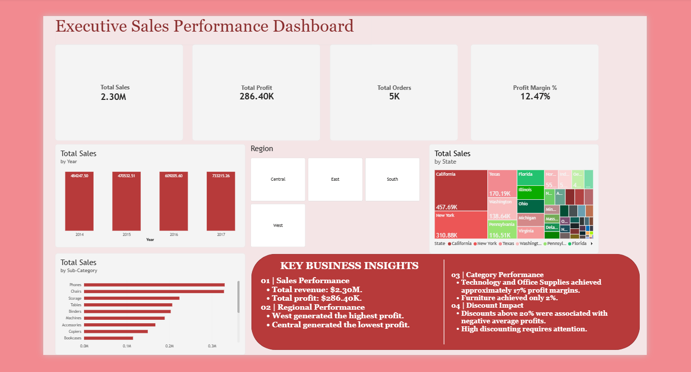

# Power BI Sales Performance Dashboard

## Project Overview
This project presents an interactive Sales Performance Dashboard built using Microsoft Power BI and the Sample Superstore dataset.

The dashboard helps analyse sales, profit, orders, regional performance, and product categories.

## Tools Used
- Microsoft Power BI
- Microsoft Excel
- Sample Superstore Dataset

## Key Performance Indicators
- Total Sales: $2.30M
- Total Profit: $286.40K
- Total Orders: 5,009
- Profit Margin: 12.47%

## Key Insights
1. The West region generated the highest profit.
2. The Central region generated the lowest profit.
3. Technology and Office Supplies had stronger profit margins than Furniture.
4. Higher discounts were associated with lower average profits.

## Dashboard Preview

## Project Files
- Power BI dashboard (.pbix)
- Dashboard screenshot (.png)

## Author
BBA Data Analytics Student
